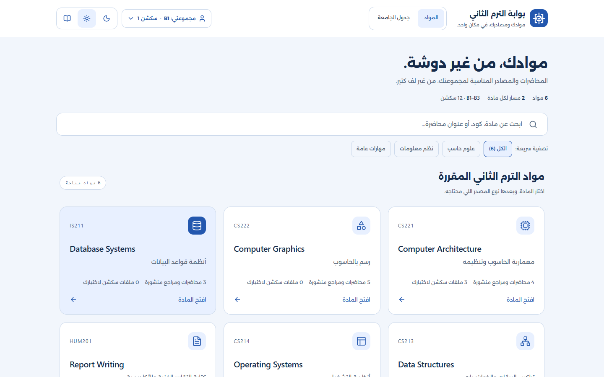
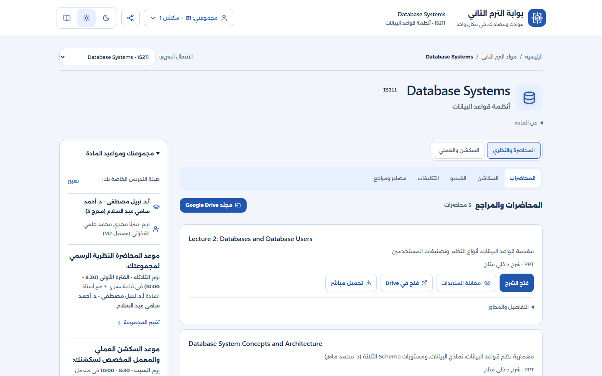
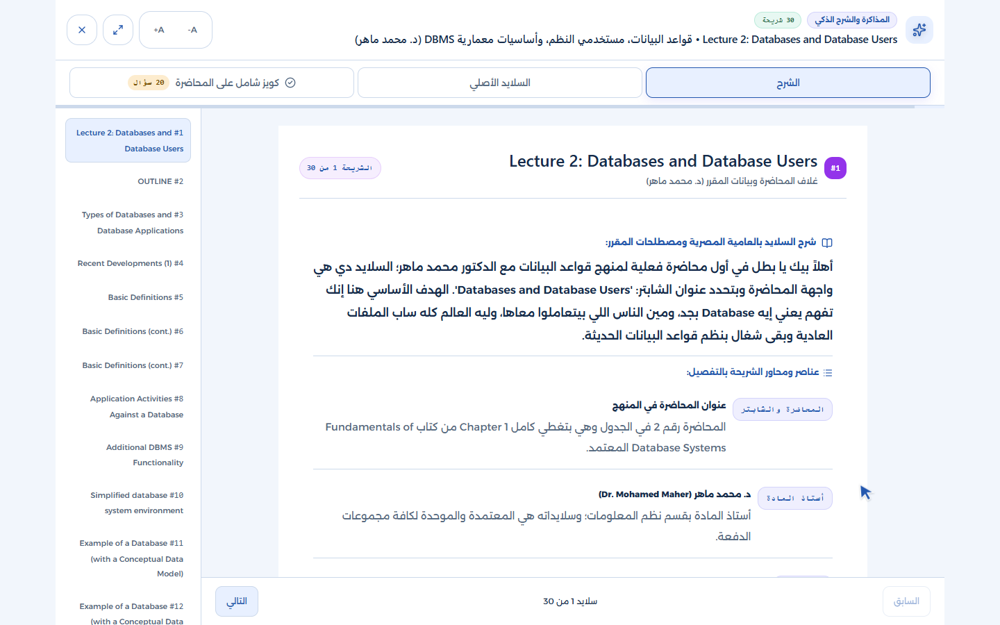
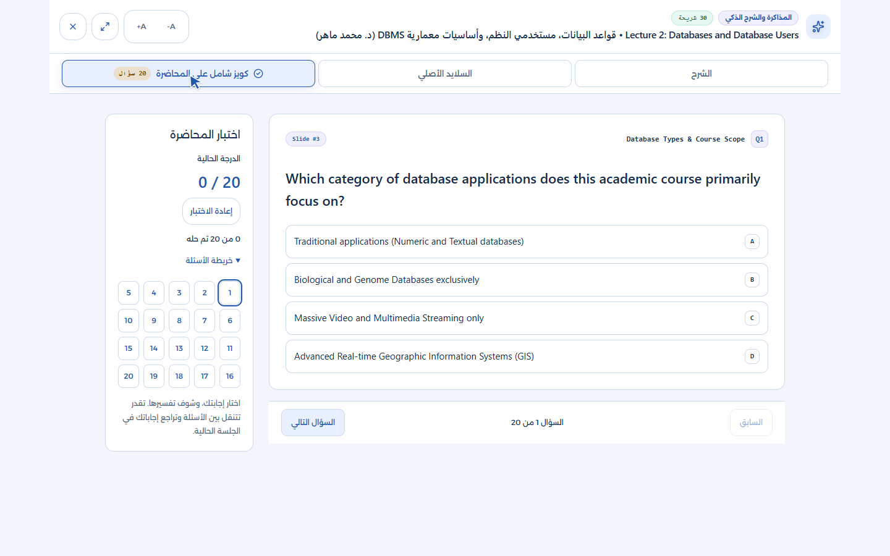
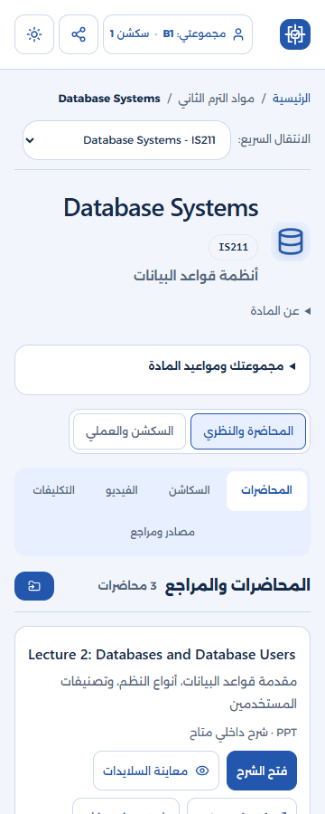

# تسليم تجربة الطالب A1 — 21 أكتوبر 2026

تحديث التسليم للمراجعة: اعتمد المستخدم اسم **Study Hub** والعنوان «اختار مادتك وابدأ.»، ثم طلب رفع العمل على GitHub للمراجعة. [دليل المراجعة الحالي](STUDY-HUB-REVIEW.md) يوضح التشغيل والمتبقي؛ وصف «محلي فقط» أدناه يسجل حالة التسليم السابقة قبل هذا الإذن.

هذه هي النسخة الحالية بعد تصحيح ملاحظات المستخدم على ظهور الأزرار وعلى عدم نقل تجربة A1 نفسها. تقارير 20 أكتوبر تصف مرحلة سابقة، ولا تمثل وحدها دليل قبول هذه التجربة.

## ما يراه الطالب الآن

1. **اختيار المادة:** كروت مختصرة باسم إنجليزي ومعناه العربي وكود المادة وعدد المصادر المنشورة، ومدخل رئيسي واحد للمادة. تفاصيل الدكاترة والمصادر الخارجية لم تعد تملأ كل كارت.
2. **اختيار نوع المصدر:** المادة تفتح على محاضراتها مباشرة. تبويبات واضحة للمحاضرات، السكاشن، الفيديو، التكليفات، والمصادر والمراجع؛ يظهر النوع المختار فقط.
3. **فتح المصدر:** صفوف مختصرة بعنوان ومعنى عربي وأزرار المصدر الفعلية. التفاصيل والمحاور الإضافية لها إفصاح مسمّى. المواعيد وهيئة التدريس في سياق جانبي، ويمكن إظهاره على الهاتف عند الحاجة.
4. **القراءة:** مساحة مركزة لسلايد واحد، مع شرح المحتوى الحقيقي وفهرس يتابع الاختيار، السابق والتالي، والسلايد الأصلي في تبويب مستقل. التكبير وملء النافذة وأسئلة السلايدات باقية.
5. **الاختبار:** سؤال واحد في كل مرة، مع التالي والسابق وخريطة الأسئلة، والتصحيح والتفسيرات والنتيجة والإعادة بالسلوك الحالي. إعادة الاختبار تعيد التركيز للسؤال الأول، وTab يستمر داخل المحتوى المختار.
6. **جدول الجامعة:** عرض مستقل من التنقل بدل تكديسه بعد شبكة المواد؛ يحتفظ بالمجموعة والسكشن والمواعيد الحالية وتنبيهات البيانات المعلقة.

روابط التجربة:

- [الرئيسية المحلية](http://127.0.0.1:8765/).
- [محاضرات قواعد البيانات](http://127.0.0.1:8765/subject.html?id=database-systems&track=lecture&kind=lectures).
- [فيديوهات المعمارية](http://127.0.0.1:8765/subject.html?id=computer-architecture&track=lecture&kind=videos).
- [جدول الجامعة](http://127.0.0.1:8765/index.html#schedule-section).

اختيار نوع المصدر يبقى عند الانتقال السريع لمادة أخرى، ورجوع المتصفح يعيد النوع السابق. روابط المسارين القديمة وروابط التكليفات والمصادر العملية تظل مدعومة. مقدمة المعالج وFlex والـNavbar الثابت والثيمات الثلاثة باقون.

## إصلاح عيوب الظهور

كانت قواعد الخلفية تخلط بين الصنف الأساسي و`hover:bg-*`، ثم تمحو قاعدة للكروت المتداخلة خلفية الأزرار مع بقاء النص أبيض. صُحح التطابق وقواعد الأزرار الأساسية والثانوية وحالاتها، ووراثة ألوان SVG. أُزيلت أولوية ألوان قديمة كانت تتغلب على ألوان المسار والتبويب المختار، وعُدّل تباين التحميل وفلاتر المعيدين واختيار السكشن ونتائج الكويز.

ظهر أيضًا أن أيقونة Youtube غير موجودة في نسخة Lucide المحلية؛ استُخدمت أيقونة MonitorPlay الموجودة بالفعل، مع إبقاء أسماء YouTube وروابطه كما هي. أصبحت خيارات المجموعة والسكشن تُظهر تركيز الكيبورد بوضوح.

## الحفاظ على الوظائف والمحتوى

| الوظائف | موضعها الحالي ودليل الحفاظ عليها |
|---|---|
| البحث والتخصصات والمواد الست | اختيار المادة؛ اختبارات البحث الأصلية والبحث بأسماء العرض الجديدة |
| المجموعات والسكاشن والدكاترة والمعيدون | النافبار وسياق المادة؛ 72 توليفة أصلية و144 حالة مادة/سكشن/مسار إضافية |
| كل المحاضرات والفيديوهات والسكاشن والتكليفات والمراجع والأدوات | عائلات المصادر؛ مطابقة إجراءات وروابط المصادر لكل المواد الست |
| فلاتر المعيد والموارد العامة ومجلدات Drive | سياق عائلة المصدر؛ التغيير وإعادة الرسم واختبارات الفلترة الحالية |
| المعاينة والفتح الخارجي والتحميل والنسخ ومواقـع الشرح | أزرار المصدر ومجموعة المصادر؛ اختبارات المعاينات والإغلاق وبدائل النسخ |
| الشرحان الحقيقيان، 30 و32 سلايدًا | القارئ المركز؛ كل المحتوى والصور وأسئلة السلايدات باقية |
| الكويزان، 20 و30 سؤالًا | سؤال واحد وخريطة؛ التصحيح والنتائج والإعادة وتفسير الإجابة كما هي |
| التحميل الكسول وإعادة المحاولة ومنع الفتح المتأخر | وحدات التحميل والقارئ الأصلية مع اختبارات الفشل والإغلاق |
| الوصول بالكيبورد والتركيز والحركة المخفضة | التبويبات والقارئ والكويز والنوافذ، مع اختبارات السلوك الفعلي |

لم تُغيّر بيانات المحتوى العلمي أو الأسئلة أو الصور أو روابط المصادر أو بيانات الجدول أو ملاحظات التخطيط السابقة: **77 ملفًا محميًا مطابقًا للبصمات الأصلية**. البيانات الثلاثة غير المؤكدة في الجدول تظل معلقة.

خطة ميزات المذاكرة الجديدة تظل منفصلة كما أكد المستخدم: لا حفظ تقدم أو استكمال محاولات جديد، ولا نسخ احتياطي أو بحث شامل أو بيانات نموذج تجريبية. لا تغيير لمفاتيح تخزين التفضيلات الحالية، ولا حسابات أو backend أو أتمتة جديدة.

## التحقق الحالي

- نجح `npm run verify`: البناء والصياغة والبيانات وlint، **30 اختبار Node، و23 سيناريو أصليًا، و45 سيناريو A1**.
- فحص الأزرار يغطي **192 تركيبة صفحة/ثيم/عرض شاشة**، و198 نمط تفاعل مميز بحالات hover/focus/active، وستة إعدادات لنوافذ الدراسة والمصادر. يعتمد على الخلفية المركبة والشفافية ولون النص والأيقونة، وليس وجود العنصر فقط.
- اختبارات الرحلة تشمل عزل الجدول وأنواع المصادر، فتح الشرحين الحقيقيين، السؤال الواحد، تكبير الخط فعليًا، الرجوع وتبديل المادة، التركيز بعد التنقل والإعادة، متابعة الفهرس، وظهور أول إجراء للمحاضرة على 360×900 دون المقدمات المتكررة.
- مراجعة مستقلة اختبرت الرحلة على الكمبيوتر والهاتف المحاكى، بما فيها إكمال كويز المحاضرة الثالثة. ملاحظتا الكيبورد والفهرس أُعيد إنتاجهما باختبارات فاشلة ثم صُححتا ونجحتا.
- تجربة إضافية على **Microsoft Edge** عند 1440 و360 بكسل نجحت لمسار المادة ← نوع المصدر ← الانتقال لمادة أخرى ← القارئ ← الكيبورد ← الكويز، دون أخطاء صفحة.
- صور مستقرة للرئيسية والمادة والقارئ والكويز عند 360 و390 و412 و768 و1024 و1440 بكسل، إضافة للسلايد الأصلي والفيديو والجدول.

[سجل الأدلة الحالي](a1-student-journey-evidence/evidence.json) · [التحقق الكامل](a1-student-journey-evidence/full-verify.txt) · [نتائج A1](a1-student-journey-evidence/a1-results.json) · [نتائج Edge](a1-student-journey-evidence/edge-results.json).

التحقق يستخدم متصفحات محلية وهاتفًا محاكى؛ لا يدعي اختبار هاتف فعلي أو Firefox/WebKit أو شهادة وصول شاملة أو مراجعة الصحة العلمية. الشبكة الخارجية محجوبة في اختبارات السلوك؛ الروابط محفوظة، وتوفر كل ملف وفيديو عند المزود مسألة منفصلة.

العمل محلي على النسخة والفرع الحاليين؛ لا commit أو push أو نشر. [سجل التنفيذ والقرارات](A1-STUDENT-JOURNEY-2026-10-21.md).

## صور الرحلة

