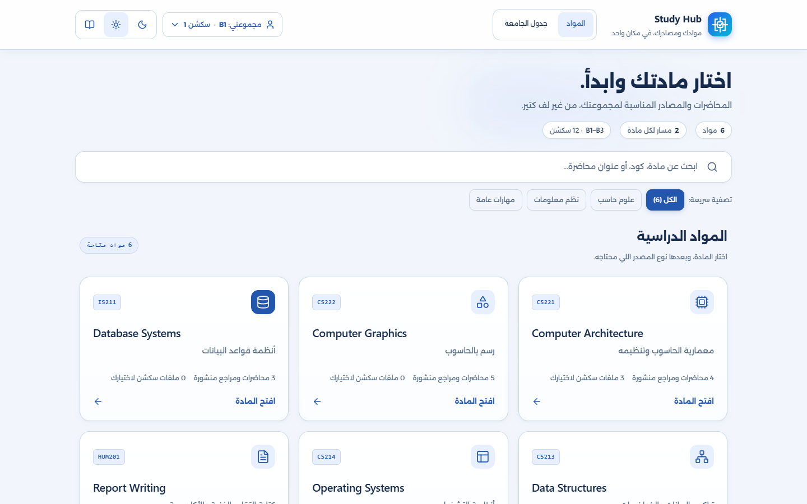
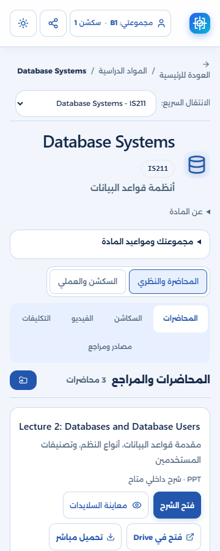
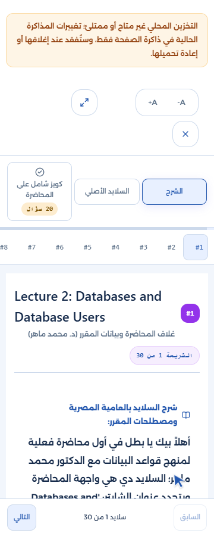

# Study 03 completion and integration handoff — 21 October 2026

Issue #7 / PR #18 is completed for review. This replaces the earlier WIP handoff; consult live GitHub status for merge/publication state.

## Result

- The synchronous PortalStudyState API and logical schema remain available; new writes publish one validated immutable operation atomically under sem2_study_v1:op:.
- Read-only legacy fields remain compatible. Failed replacement preserves persistent bytes and current state; deterministic replay merges independent tabs without stale base/lastUsed overwrites.
- Corrupt/future-schema inputs are protected at load, event and write boundaries. Invalid nested values, cycles, accessors and hidden serialization hooks cannot publish a corrupt operation.
- Session-only edits remain usable and explicitly disappear on reload. Save warnings remain visible and accessible inside active reader/quiz dialogs, without weakening focus/background isolation.
- A positional mobile CSS regression was repaired with a semantic heading selector. Existing typography, hover behavior, creator cards, schedule styling and real scientific/source content are retained.
- Cumulative Study 02 defects found during final review were fixed: practical row keys, real TA recovery hooks, and canonical/catalog URL validation. These complete existing link behavior, not later study features.

## Verification and acceptance

| Requirement | Evidence |
|---|---|
| Read/write/reload, denied/quota, corrupt/future schema, unsafe input | tests/study-state.test.cjs and tests/study-features/storage.cjs |
| Different items, base siblings, reader/quiz, lastUsed, same-field conflicts | deterministic Node interleavings plus real two-page browser cases |
| Atomic replacement / concurrent update / deletion / failure | persistent-byte, fresh-instance and second-page assertions; no best-effort rollback |
| Accessible warning inside study dialogs | actual reader/quiz quota-failure browser test and warning screenshots |
| Mobile primary action and hover states | all original 45 A1 scenarios, including four initially failed cases |
| Existing content/profile/media behavior | original 23 browser scenarios and protected scientific/content hashes |
| Cumulative source-link recovery | seven link browser scenarios with actual clicks and target visibility |

The complete verification passed build, syntax, data, lint, **64 Node tests, 23 original browser scenarios, 45 A1 scenarios and 14 study-feature scenarios**. The same 14 feature scenarios also passed in installed Edge. A fresh independent review rechecked the final fixes with no remaining merge blockers.

[Full verification](study03-evidence/full-verify.txt) · [acceptance record](study03-evidence/acceptance.json) · [Edge results](study03-evidence/edge-features.txt).

## Continue development

Read docs/STUDY-FEATURE-CONTRACTS.md before Issue #8 or #9. Consumers use the state API; do not write physical storage keys directly or reimplement conflict handling. No persisted quiz consumer, reader resume, progress dashboard or backup UI was added in this issue.

The journal deliberately has no automatic compaction. Storage quota switches to the documented session overlay. Explicit restoration over protected corrupt/newer bytes requires a separately reviewed recovery contract; the default replaceAll refuses it. Future backup work must not bypass that guard implicitly.

The cumulative main integration preserves the collaborator's commits. The unrelated collaborator/motion-engine-wip branch is excluded. Main is the existing Pages source, so verify publication and the deployed subpath after merge.

## Review captures

Captures use isolated browser contexts; the quota failure is intentional test injection, not a failure report for real student data. See acceptance.json for actual verification limits.
