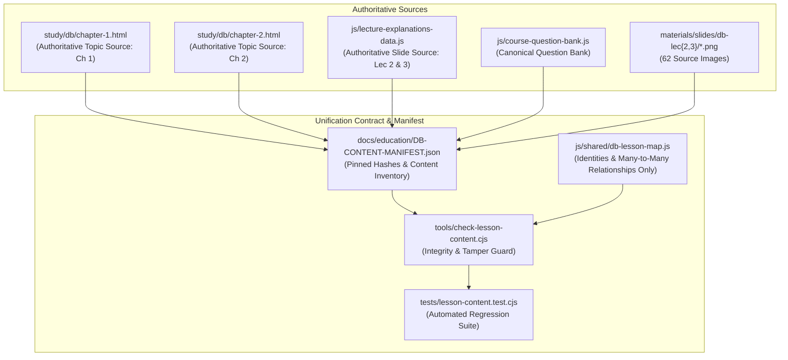
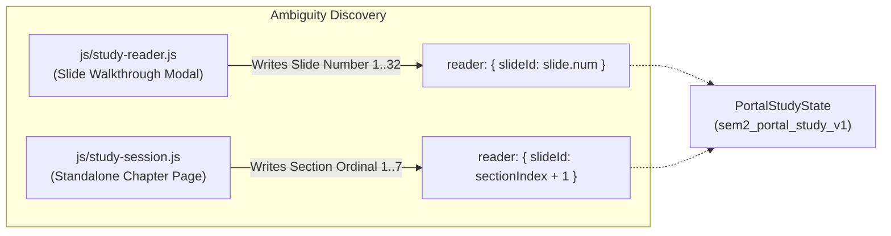

# Database Systems Educational Unification Contract
## Mapping and Exact Content Preservation for DB Chapters 1 & 2 (Lectures 2 & 3)

| Metadata | Details |
| :--- | :--- |
| **Document ID** | `DB-UNIFICATION-CONTRACT-V1` |
| **Assigned Issue** | [#28 — [Learning UI 01] Map both DB explanations and enforce exact content preservation](https://github.com/ahm-333/Sem2_portal/issues/28) |
| **Parent Epic** | [#27 — [Learning UI roadmap] Combine DB lesson capabilities and unify educational presentation](https://github.com/ahm-333/Sem2_portal/issues/27) |
| **Root Roadmap** | [#4 — [Study roadmap] Reconcile remaining study features with current Kernal/Studio](https://github.com/ahm-333/Sem2_portal/issues/4) |
| **Accepted Main Baseline** | `752c6ea41be02abd04c9fb4927b85788e3312f3f` (and current main `049f360`) |
| **Scope Status** | Architectural Contract & Cryptographic Content Freeze |

---

## 1. Executive Summary & Objective

This contract freezes a lossless, many-to-many mapping between the two existing representations of Database Systems course content before any student-facing presentation changes occur:
1. **The Standalone Chapter Pages** (`study/db/chapter-1.html`, `study/db/chapter-2.html`), which provide rich topic-oriented prose, Egyptian-vernacular explanations, conceptual figures, and interactive topic quizzes.
2. **The Slide Walkthrough Explanations** (`js/lecture-explanations-data.js` under `LECTURE_EXPLANATIONS['database-systems']['2']` and `['3']`), which provide slide-by-slide breakdowns, points, diagram deconstructions, exam triggers, exam tricks, keywords, slide quizzes, and full lecture quizzes.

This contract and its accompanying artifacts (`docs/education/DB-CONTENT-MANIFEST.json`, `js/shared/db-lesson-map.js`, `tools/check-lesson-content.cjs`, and `tests/lesson-content.test.cjs`) guarantee complete preservation of every authored scientific sentence, heading, code snippet, formula, diagram label, table cell, source URL, question choice, correct answer index, and explanation.

> [!IMPORTANT]
> This is an interface-contract and content-preservation task. No student-facing UI redesign, routing cutover, storage schema modification, or source text rewriting/deduplication is authorized in this issue.

---

## 2. Authoritative Sources & Dual Representations

The system maintains two authoritative sources of truth without duplicating raw authored prose in presentation mapping modules:



1. **Authoritative Topic Source**:
   - `study/db/chapter-1.html` for Chapter 1 (Lecture 2: *Databases and Database Users*).
   - `study/db/chapter-2.html` for Chapter 2 (Lecture 3: *Database System Concepts and Architecture*).
2. **Authoritative Slide Source**:
   - `LECTURE_EXPLANATIONS['database-systems']['2']` and `['3']` in `js/lecture-explanations-data.js`.
3. **Authoritative Question Source**:
   - Standalone questions: embedded within the chapter HTML files, indexed in `COURSE_QUESTION_BANK`.
   - Full-quiz questions: defined in `LECTURE_EXPLANATIONS.fullQuiz`, indexed in `COURSE_QUESTION_BANK`.
   - Slide-quiz questions: defined in `LECTURE_EXPLANATIONS.slides[].quiz`, namespaced deterministically.

---

## 3. Exact Content Inventory & Authored Records

The inventory establishes exact counts of authored educational records across both representations. These numbers represent authored records, not claims of semantic uniqueness:

### 3.1 Lecture 2 / Chapter 1: Databases and Database Users
- **Standalone Teaching Blocks**: 7 blocks (`block-1`, `block-2`, `block-3`, `block-4`, `block-5`, `block-6`, `block-add`).
- **Original Slides**: 30 slides (`materials/slides/db-lec2/slide_1.png` to `slide_30.png`).
- **Standalone Practice Questions**: 34 questions (canonical IDs `study/db/chapter-1.html:1` through `34`).
- **Full-Quiz Questions**: 20 questions (canonical IDs `subject.html?id=database-systems&lecture=2:1` through `20`).
- **Slide-Quiz Questions**: 30 questions (namespaced IDs `db:lec2:s1:quiz` through `db:lec2:s30:quiz`).
- **Subtotal Questions**: 84 authored questions.

### 3.2 Lecture 3 / Chapter 2: Database System Concepts and Architecture
- **Standalone Teaching Blocks**: 6 blocks (`block-1`, `block-2`, `block-3`, `block-4`, `block-5`, `block-6`).
- **Original Slides**: 32 slides (`materials/slides/db-lec3/slide_1.png` to `slide_32.png`).
- **Standalone Practice Questions**: 20 questions (canonical IDs `study/db/chapter-2.html:1` through `20`).
- **Full-Quiz Questions**: 30 questions (canonical IDs `subject.html?id=database-systems&lecture=3:1` through `30`).
- **Slide-Quiz Questions**: 32 questions (namespaced IDs `db:lec3:s1:quiz` through `db:lec3:s32:quiz`).
- **Subtotal Questions**: 82 authored questions.

### 3.3 Grand Totals
- **Total Authored Questions**: $84 + 82 = 166$ questions.
- **Total Preserved Slide Images**: $30 + 32 = 62$ PNG assets.
- **Visual Figures & Tables**: All embedded SVGs, tables, and architectural visual cards are pinned and preserved without simplification.

---

## 4. Many-to-Many Relationship Mapping Specification

Because the standalone chapter pages structure knowledge by thematic topic blocks while slides structure knowledge in chronological lecture sequence, the relationship between topic blocks and slides is inherently **many-to-many** ($M:N$).

### 4.1 Lecture 2 / Chapter 1 Mapping Matrix

| Block ID | Block Title | Mapped Slides | Block Access Path | Source Locator |
| :--- | :--- | :--- | :--- | :--- |
| `block-1` | المفاهيم الأساسية: البيانات، العالم المصغر، وقاعدة البيانات | 5, 6, 7 | `chapter-1:block-1` | `study/db/chapter-1.html#block-1` |
| `block-2` | نظام الـ DBMS، وظائفه، بيئته، والـ Meta-data & Catalog | 5, 6, 8, 9, 10, 15 | `chapter-1:block-2` | `study/db/chapter-1.html#block-2` |
| `block-3` | أنواع قواعد البيانات وتطبيقاتها + محركات البحث والـ Cloud | 3, 4 | `chapter-1:block-3` | `study/db/chapter-1.html#block-3` |
| `block-4` | الخصائص الجوهرية الأربعة لمدخل قواعد البيانات مقابل الملفات | 14, 16, 17, 18 | `chapter-1:block-4` | `study/db/chapter-1.html#block-4` |
| `block-5` | مستخدمو قواعد البيانات: أبطال على المسرح وخلف الكواليس | 19, 20, 21, 22, 23, 24 | `chapter-1:block-5` | `study/db/chapter-1.html#block-5` |
| `block-6` | مميزات الـ DBMS التسعة، الفوائد الإدارية، ومتى نتجنبه | 25, 26, 27, 28, 29 | `chapter-1:block-6` | `study/db/chapter-1.html#block-6` |
| `block-add`| النقاط الخمس الذهبية + رسمة قاعدة بيانات الجامعة | 11, 12, 13, 23, 24, 25, 29 | `chapter-1:block-add` | `study/db/chapter-1.html#block-add` |

#### Unmatched Standalone Slides in Lecture 2:
- **Slide 1 (Cover)**: Title & Instructor information. Mapped to `lecture-explanations:db:2:slide:1` (accessible via unified slide outline).
- **Slide 2 (Outline)**: Chapter topics overview. Mapped to `lecture-explanations:db:2:slide:2`.
- **Slide 30 (Lecture Summary)**: 10-point comprehensive review. Mapped to `lecture-explanations:db:2:slide:30`.

---

### 4.2 Lecture 3 / Chapter 2 Mapping Matrix

| Block ID | Block Title | Mapped Slides | Block Access Path | Source Locator |
| :--- | :--- | :--- | :--- | :--- |
| `block-1` | 1. تجريد البيانات ونماذج البيانات (Data Abstraction & Data Models) | 3, 4, 5, 6, 8, 11 | `chapter-2:block-1` | `study/db/chapter-2.html#block-1` |
| `block-2` | 2. المخطط، الحالة، واللقطة (Schemas, Instances, and Database State) | 12, 13, 14, 16, 17 | `chapter-2:block-2` | `study/db/chapter-2.html#block-2` |
| `block-3` | 3. معمارية المستويات الثلاثة واستقلالية البيانات (Three-Schema) | 18, 20, 21, 22, 23 | `chapter-2:block-3` | `study/db/chapter-2.html#block-3` |
| `block-4` | 4. معماريات نظم قواعد البيانات والـ Client/Server | 24, 26, 27, 28, 29, 30, 31, 32 | `chapter-2:block-4` | `study/db/chapter-2.html#block-4` |
| `block-5` | 5. الرسومات المعمارية الأربعة الرسمية (Architectural Visuals) | 20, 21, 24, 25, 28, 32 | `chapter-2:block-5` | `study/db/chapter-2.html#block-5` |
| `block-6` | 6. فك شفرات وتريكات الامتحان الحرفية (Exam Cipher & Traps) | 3 through 32 (Synthesis) | `chapter-2:block-6` | `study/db/chapter-2.html#block-6` |

#### Unmatched Standalone Slides in Lecture 3 (Specialized Case Studies):
- **Slide 1 (Cover)**: Lecture Title & Metadata. Access path: `lecture-explanations:db:3:slide:1`.
- **Slide 2 (Outline)**: Course outline. Access path: `lecture-explanations:db:3:slide:2`.
- **Slide 7 (COMPANY ER Diagram)**: Comprehensive entity-relationship model of the COMPANY database. Access path: `lecture-explanations:db:3:slide:7`. Tag: `company-example`.
- **Slide 9 (COMPANY Relational Schema Diagram)**: Full schema with foreign keys. Access path: `lecture-explanations:db:3:slide:9`. Tag: `company-example`.
- **Slide 10 (Object Data Model & UML Class Diagram)**: UML classes and associations. Access path: `lecture-explanations:db:3:slide:10`. Tag: `uml-example`.
- **Slide 15 (COMPANY Database State - Figure 5.6)**: Populated database instance with sample tuples. Access path: `lecture-explanations:db:3:slide:15`. Tag: `company-example`.
- **Slide 19 (Staff Record & DOB Concrete Example)**: Demonstrates internal storage vs conceptual record vs external view (Date of Birth derivation). Access path: `lecture-explanations:db:3:slide:19`. Tag: `staff-dob-example`.

> [!CAUTION]
> Every authored slide and block MUST have a designated access path and source locator. An unmapped record is considered a guard violation and causes `tools/check-lesson-content.cjs` to reject the change. Records must never silently disappear.

---

## 5. Unified Lesson Workspace Model (OS Reference Pattern)

Downstream children (#30, #31, #32, #33) will build and integrate the unified lesson workspace adhering to the visual reference established by Operating Systems (`education-preview/os/index.html`):

```
┌────────────────────────────────────────────────────────────────────────┐
│                        TOP NAV & STUDY CONTROLS                        │
│ [← Back]  [Course & Lecture Title]   [Light/Sepia/Dark]  [Zoom +/-]    │
├───────────────┬────────────────────────────────────────────────────────┤
│ OUTLINE       │                   MAIN STUDY BODY                      │
│               │                                                        │
│ • Topic 1     │  [Topic Block Reading View]                            │
│   ├ Slide 5   │  Detailed vernacular prose, headings, formulas,        │
│   └ Slide 6   │  code blocks, and embedded interactive figures.        │
│               │                                                        │
│ • Topic 2     │  ──────────────────────────────────────────────────    │
│   ├ Slide 8   │  [Contextual Slide Viewer / Modal]                     │
│   └ Slide 10  │  Original slide image (High-Res) + Points breakdown    │
│               │  + Diagram deconstruction + Exam tips & triggers       │
│ • Examples    │                                                        │
│   (COMPANY,   │  ──────────────────────────────────────────────────    │
│    UML, Staff)│  [Grouped Practice Area]                               │
│               │  • Topic Questions (34 / 20)                           │
│ • Practice    │  • Full Exam Quiz (20 / 30)                            │
│               │  • Slide-by-slide Practice (30 / 32)                   │
└───────────────┴────────────────────────────────────────────────────────┘
```

### Core Workspace Requirements:
1. **Single Entry Point**: One clear outline linking topic blocks and contextual slides without competing primary navigation buttons.
2. **Contextual Slide Access**: Students reading a topic can jump directly to the relevant slides and return to their exact scroll position.
3. **Practice Grouping**: Practice options are cleanly grouped without merging scores or diluting bank identities.
4. **Theme Synchronization**: Light, sepia, and dark modes synchronize seamlessly with the portal shell and open tabs.

---

## 6. Technical Loading Strategy & Honest Fallback

To prevent performance regressions and security vulnerabilities, lesson integration must follow strict technical loading rules:

1. **Lazy Same-Origin DOM Extraction**:
   - Chapter HTML is loaded asynchronously on demand using `fetch()`.
   - The document is parsed using `DOMParser`.
   - Only allowlisted elements (`<section id="block-...">`, `<article id="block-...">`, `<style>`, `<svg>`) are extracted.
   - **Old inline `<script>` tags are strictly stripped and never executed** to prevent memory leaks and unexpected side effects.
2. **Honest `file://` Fallback**:
   - When the portal is opened via `file://` protocol, modern browsers restrict cross-file asynchronous `fetch()` requests due to CORS/Origin restrictions.
   - The workspace MUST detect when `file://` prevents content extraction, and honestly render a fallback card with a direct local link to the original chapter page (`study/db/chapter-1.html` or `chapter-2.html`), preserving basic navigation without throwing unhandled exceptions.

---

## 7. Question Identity & Namespacing Rules

Question banks remain independent and immutable. No question is renumbered or deleted:

1. **Standalone Topic Questions**:
   - Retain canonical IDs from `COURSE_QUESTION_BANK`:
     - Chapter 1: `study/db/chapter-1.html:1` to `34`
     - Chapter 2: `study/db/chapter-2.html:1` to `20`
2. **Full-Quiz Questions**:
   - Retain canonical IDs from `COURSE_QUESTION_BANK`:
     - Lecture 2: `subject.html?id=database-systems&lecture=2:1` to `20`
     - Lecture 3: `subject.html?id=database-systems&lecture=3:1` to `30`
3. **Slide-Quiz Questions**:
   - Namespaced deterministically by lecture and slide:
     - Lecture 2: `db:lec2:s1:quiz` to `db:lec2:s30:quiz`
     - Lecture 3: `db:lec3:s1:quiz` to `db:lec3:s32:quiz`
   - Preserve authored stem, options, correct answer index, and explanation.

---

## 8. State Compatibility & The `reader.slideId` Ambiguity

During architectural review of the existing codebase, an ambiguity was identified in how `reader.slideId` is recorded in persistent study state:



### Specific Ambiguity Details:
- In `js/study-reader.js` (lines 34–37), `slideId` represents the **slide number** ($1 \dots 30$ in Lec 2; $1 \dots 32$ in Lec 3).
- In `js/study-session.js` (lines 53–58), `slideId` represents the **section ordinal** ($1 \dots 7$ for anchors `block-1` through `block-add`).
- Reinterpreting a saved numeric value blindly could cause a student who was reading Section 4 in the standalone page to be restored to Slide 4 in the modal, or vice-versa.

### Explicit Architectural Decisions:
1. **No Schema Changes**: Under no circumstances should new fields or modifications be added to `journal schemaVersion1` (as protected by Issue #7 and #9).
2. **Resolution Reserved for #34**: The resolution of this ambiguity via source-aware location adapters (e.g. anchor aliases, bridge reconciliation, or mode qualifiers) is **strictly reserved for Child Issue #34** (`[Learning UI 07] Preserve resume and old DB links through the unified workspace`).
3. **Current Behavior Preserved**: Issue #28 records and documents this boundary, maintaining complete backward compatibility.

---

## 9. Accessibility (WCAG 2.2 AA) & Design System Standards

Downstream lesson workspace implementations must comply with the following WCAG 2.2 AA criteria:

1. **Color Contrast (1.4.3 Contrast Minimum)**:
   - Text and images of text must maintain a contrast ratio of at least $4.5:1$ for regular text and $3:1$ for large text ($18\text{pt}$ or $14\text{pt}$ bold) across all themes: Dark (`#0b1120`), Light (`#f8fafc`), and Sepia (`#f6f0e0`).
   - UI components and graphical objects must maintain at least $3:1$ against adjacent colors.
2. **Keyboard Accessibility (2.1.1 Keyboard)**:
   - All interactive controls (topic links, slide jumpers, tabs, quiz buttons) must be operable via keyboard (`Tab`, `Shift+Tab`, `Enter`, `Space`).
   - Focus indicators must be prominent and visible (`focus-visible`).
3. **Touch Targets (2.5.8 Target Size Minimum)**:
   - Interactive targets must be at least $44 \times 44\text{px}$ or provide sufficient spacing to prevent accidental taps on mobile devices.
4. **Motion Preferences (2.3.3 Animation from Interactions)**:
   - When `prefers-reduced-motion: reduce` is active, animations and smooth scrolling must be disabled or simplified to instant transitions.
5. **ARIA & Semantics**:
   - Navigation lists must use semantic `<nav>`, `<ol>`, or `<ul>` elements.
   - Tabs must implement `role="tab"`, `role="tablist"`, `role="tabpanel"`, and `aria-selected`.
   - Modals must implement `role="dialog"`, `aria-modal="true"`, and label references.

---

## 10. Cryptographic Guard & Approved Corrections

To ensure that no regression occurs over time, the verification tool `tools/check-lesson-content.cjs` and the test suite `tests/lesson-content.test.cjs` enforce the following cryptographic assertions:

1. **Payload & Media Hashes**:
   - Every block, slide, question, and image has its SHA-256 hash pinned in `docs/education/DB-CONTENT-MANIFEST.json`.
   - Any modification to scientific prose, formulas, code punctuation, diagram labels, options, or correct answers immediately fails verification.
2. **Whitespace Tolerance**:
   - Outside `<pre>` and `<code>` blocks, standard whitespace normalization (collapsing extra spaces/newlines) is permitted to accommodate HTML formatting. Inside code and formulas, punctuation and whitespace must remain exact.
3. **Approved UI Copy Allowlist**:
   - A single approved UI correction is documented in the manifest: In `study/db/chapter-1.html`, the filter button label `كل الأسئلة (30)` is allowed to be corrected to `كل الأسئلة (34)` to reflect the actual sum of authored questions ($4 + 10 + 5 + 5 + 5 + 5 = 34$). The scientific questions themselves are completely preserved.

---

## 11. Child Issues Traceability & Implementation Boundaries

| Issue | Title | Dependency Gate | Scope Boundary |
| :--- | :--- | :--- | :--- |
| **#28** | Map both DB explanations and enforce exact content preservation | None (Starts with accepted main) | Contract, manifest, mapping, and integrity tests (**Current**) |
| **#29** | Synchronize light, dark and reading across the whole portal | #28 | Global theme/reading storage & cross-tab synchronization |
| **#30** | Build one lesson workspace and reuse the existing slide renderer | #28, #29, #8, #9 | Unified workspace UI container & lazy slide renderer |
| **#31** | Integrate DB Chapter 1 into the combined lesson | #28, #30 | Chapter 1 reading adapter & slide alignment |
| **#32** | Integrate DB Chapter 2 and preserve its detailed examples | #28, #31 | Chapter 2 reading adapter, COMPANY/UML/Staff examples |
| **#33** | Combine access to DB practice without mixing banks or grades | #28, #30 | Grouped practice navigation & bank isolation |
| **#34** | Preserve resume and old DB links through the unified workspace | #28, #31, #32, #33 | URL aliases, bridge recovery, and `reader.slideId` resolution |

---

*Contract Approved and Certified under Issue #28.*
